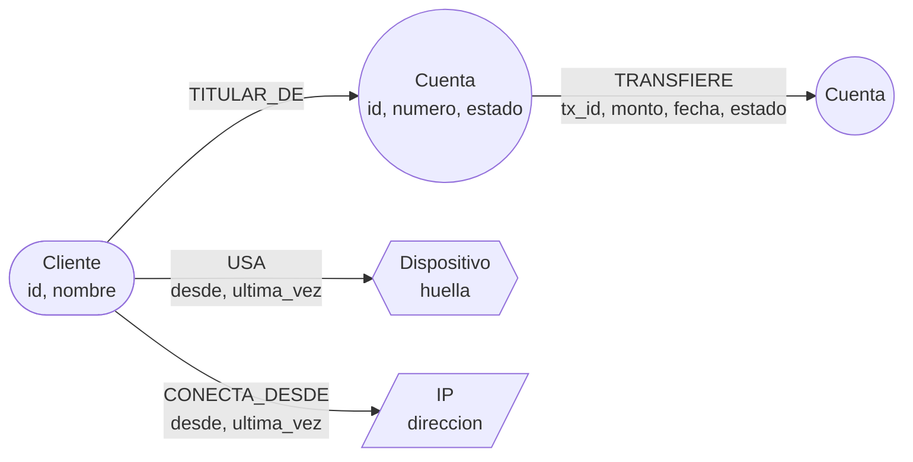

# Base de datos de Banco Rosberg

Modelo de datos, diccionario y decisiones de diseño.

**Contenido**

1. [Visión general: dos bases, dos trabajos](#1-visión-general-dos-bases-dos-trabajos)
2. [Modelo entidad-relación (MySQL)](#2-modelo-entidad-relación-mysql)
3. [Diccionario de datos](#3-diccionario-de-datos)
4. [Lógica dentro de la base](#4-lógica-dentro-de-la-base)
5. [Usuarios de MySQL y privilegios](#5-usuarios-de-mysql-y-privilegios)
6. [Esquema del simulador (`banco_sim`)](#6-esquema-del-simulador-banco_sim)
7. [Modelo del grafo (Neo4j)](#7-modelo-del-grafo-neo4j)
8. [Sincronización MySQL → Neo4j](#8-sincronización-mysql--neo4j)
9. [Justificación de las decisiones de diseño](#9-justificación-de-las-decisiones-de-diseño)

---

## 1. Visión general: dos bases, dos trabajos

El proyecto usa **persistencia políglota**: cada tipo de dato vive en la base que mejor lo maneja.

| | **MySQL 8.4** (relacional) | **Neo4j 5.26** (grafos) |
|---|---|---|
| Papel | **Fuente de verdad** | **Motor de análisis** |
| Guarda | Usuarios, cuentas, saldos, transacciones, alertas, auditoría | Clientes, cuentas, dispositivos, IPs y transferencias como nodos y relaciones |
| Garantiza | Transacciones **ACID**: el dinero nunca se pierde ni se duplica | Consultas rápidas sobre **relaciones** (caminos, ciclos, nodos compartidos) |
| Si se cae | El banco no puede operar (responde 503 y se recupera solo) | El banco sigue operando; el grafo se reconstruye desde MySQL al volver |

Hay tres esquemas:

| Esquema | Motor | Contenido |
|---|---|---|
| `banco` | MySQL | Los datos del banco (22 tablas, 2 vistas, 3 funciones, 6 procedimientos, 5 triggers) |
| `banco_sim` | MySQL | La "hoja de respuestas" del simulador (5 tablas). Un banco real no tendría esto; por eso está aparte |
| `neo4j` | Neo4j | El grafo de relaciones |

---

## 2. Modelo entidad-relación (MySQL)

```mermaid
erDiagram
    USUARIOS ||--o{ CUENTAS : "es titular de"
    USUARIOS ||--o{ SESIONES : "abre"
    USUARIOS ||--o{ DISPOSITIVOS : "usa"
    USUARIOS |o--o{ EVENTOS_LOGIN : "intenta entrar"
    USUARIOS ||--o{ AVISOS_LOGIN : "recibe"
    DISPOSITIVOS |o--o{ EVENTOS_LOGIN : "desde"
    DISPOSITIVOS |o--o{ AVISOS_LOGIN : "desde"
    DISPOSITIVOS |o--o{ TRANSACCIONES : "desde"
    CUENTAS |o--o{ TRANSACCIONES : "origen"
    CUENTAS |o--o{ TRANSACCIONES : "destino"
    USUARIOS |o--o{ TRANSACCIONES : "ejecuta o resuelve"
    CUENTAS ||--o{ LLAVES : "tiene"
    CUENTAS ||--o{ CODIGOS_RETIRO : "genera"
    USUARIOS |o--o{ CODIGOS_RETIRO : "canjea (cajero)"
    TRANSACCIONES |o--o| CODIGOS_RETIRO : "resulta de"
    CUENTAS ||--o{ ALERTAS_FRAUDE : "recibe"
    TRANSACCIONES |o--o{ ALERTAS_FRAUDE : "origina"
    USUARIOS |o--o{ ALERTAS_FRAUDE : "resuelve (analista)"
    USUARIOS ||--o{ TIQUETES : "pide ayuda (cliente)"
    USUARIOS |o--o{ TIQUETES : "atiende (asesor)"
    TIQUETES ||--o{ MENSAJES_TIQUETE : "contiene"
    USUARIOS ||--o{ MENSAJES_TIQUETE : "escribe"
    SOLICITUDES_PUBLICAS ||--o{ RESPUESTAS_SOLICITUD : "recibe"
    USUARIOS ||--o{ RESPUESTAS_SOLICITUD : "responde (empleado)"
    RESPUESTAS_AUTOMATICAS ||--|{ PALABRAS_RESPUESTA : "se activa con"
    RESPUESTAS_AUTOMATICAS ||--o{ RESPUESTAS_RELACIONADAS : "sugiere"
    RESPUESTAS_AUTOMATICAS |o--o{ CONSULTAS_ASISTENTE : "se uso en"
    TIQUETES ||--o{ CONSULTAS_ASISTENTE : "registra"
    RESPUESTAS_AUTOMATICAS |o--o{ TIQUETES : "ultimo tema"

    USUARIOS {
        bigint id PK
        varchar email UK
        varchar password_hash "Argon2id"
        enum rol "cliente cajero analista admin"
        varchar nombre
        varbinary documento_cifrado "AES-GCM"
        char documento_hash UK "indice ciego HMAC"
        varbinary telefono_cifrado "AES-GCM"
        varbinary totp_secreto_cifrado
        boolean totp_activo
        bigint totp_ultimo_paso
        tinyint intentos_fallidos
        datetime bloqueado_hasta
        boolean debe_cambiar_password
        boolean activo
        datetime creado_en
    }
    SESIONES {
        char id PK "jti del token"
        bigint usuario_id FK
        bigint dispositivo_id
        varchar ip
        datetime creada_en
        datetime expira_en
        boolean revocada
    }
    CUENTAS {
        bigint id PK
        char numero UK "12 digitos"
        bigint usuario_id FK
        enum tipo "ahorros corriente"
        decimal saldo "CHECK >= 0"
        enum estado "activa congelada cerrada"
        datetime creada_en
    }
    DISPOSITIVOS {
        bigint id PK
        bigint usuario_id FK
        char huella "SHA-256"
        varchar descripcion
        boolean confiable
        datetime primera_vez
        datetime ultima_vez
    }
    AVISOS_LOGIN {
        bigint id PK
        bigint usuario_id FK
        bigint dispositivo_id FK
        varchar ip
        varchar motivo
        enum estado "pendiente reconocido no_reconocido"
        datetime creado_en
        datetime resuelto_en
    }
    EVENTOS_LOGIN {
        bigint id PK
        bigint usuario_id FK
        varchar email_intentado
        varchar ip
        bigint dispositivo_id FK
        boolean exito
        datetime fecha
    }
    TRANSACCIONES {
        bigint id PK
        enum tipo "deposito retiro transferencia"
        bigint cuenta_origen_id FK
        bigint cuenta_destino_id FK
        decimal monto "CHECK > 0"
        enum estado "aprobada retenida bloqueada rechazada"
        tinyint puntaje_riesgo "0 a 100"
        varchar ip
        bigint dispositivo_id FK
        bigint ejecutada_por FK
        varchar clave_idempotencia UK
        varchar mensaje "nota del que envia"
        datetime creada_en
        datetime resuelta_en
        bigint resuelta_por FK
    }
    LLAVES {
        bigint id PK
        bigint cuenta_id FK
        enum tipo "celular correo"
        varchar valor
        boolean activa
        tinyint activa_marca "columna generada"
        datetime creada_en
    }
    CODIGOS_RETIRO {
        bigint id PK
        bigint cuenta_id FK
        char codigo_hash "HMAC"
        decimal monto
        tinyint puntaje_riesgo
        enum estado "activo usado vencido bloqueado cancelado"
        tinyint intentos_fallidos
        datetime creado_en
        datetime expira_en
        datetime usado_en
        bigint canjeado_por FK
        bigint transaccion_id FK
    }
    ALERTAS_FRAUDE {
        bigint id PK
        bigint transaccion_id FK
        bigint cuenta_id FK
        tinyint puntaje
        json motivos
        enum estado "abierta en_revision confirmada descartada"
        bigint analista_id FK
        text nota
        datetime creada_en
        datetime resuelta_en
    }
    REGLAS_FRAUDE {
        varchar codigo PK
        varchar descripcion
        enum motor "mysql neo4j"
        tinyint peso
        decimal umbral
        boolean activa
    }
    CONFIGURACION {
        varchar clave PK
        varchar valor
        varchar descripcion
    }
    AUDITORIA {
        bigint id PK
        bigint usuario_id
        varchar accion
        varchar entidad
        bigint entidad_id
        json detalle
        varchar ip
        datetime fecha
        char hash_anterior
        char hash
    }
    SOLICITUDES_PUBLICAS {
        bigint id PK
        enum tipo "tarjeta contacto empleo"
        varchar email
        varchar mensaje
        varchar ip
        boolean atendida
        datetime creada_en
    }
    TIQUETES {
        bigint id PK
        bigint cliente_id FK
        enum tema
        varchar asunto
        enum estado "nuevo en_atencion cerrado"
        bigint asesor_id FK
        tinyint calificacion "1 a 5"
        bigint visto_cliente_id
        bigint visto_asesor_id
        boolean asistente_activo
        tinyint asistente_fallos
        datetime asistente_desde
        datetime actualizado_en
    }
    MENSAJES_TIQUETE {
        bigint id PK
        bigint tiquete_id FK
        bigint autor_id FK "NULL si es del asistente"
        boolean automatico
        varchar texto
        datetime creado_en
    }
    RESPUESTAS_SOLICITUD {
        bigint id PK
        bigint solicitud_id FK
        bigint autor_id FK
        varchar texto
        enum estado_envio "pendiente enviado fallido"
        datetime enviado_en
    }
    RESPUESTAS_AUTOMATICAS {
        bigint id PK
        varchar clave UK
        varchar titulo
        varchar pregunta "texto del boton"
        varchar respuesta "admite {CLAVES} de configuracion"
        enum accion "datos del cliente a mostrar"
        tinyint prioridad "1 a 10"
        boolean activa
        int usos
        int util_si
        int util_no
    }
    PALABRAS_RESPUESTA {
        bigint respuesta_id PK, FK
        varchar palabra PK "minusculas, sin tildes"
    }
    RESPUESTAS_RELACIONADAS {
        bigint respuesta_id PK, FK
        bigint relacionada_id PK, FK
    }
    SINONIMOS {
        varchar palabra PK
        varchar equivale
    }
    CONSULTAS_ASISTENTE {
        bigint id PK
        bigint tiquete_id FK
        varchar texto
        enum resultado "respondio no_entendio derivo"
        bigint respuesta_id FK
        boolean revisada
    }
```



`REGLAS_FRAUDE`, `CONFIGURACION`, `AUDITORIA` y `SOLICITUDES_PUBLICAS` no tienen relaciones de clave foránea a propósito: las dos primeras son parámetros del sistema, la auditoría debe conservar el registro aunque la fila a la que se refiere cambie y las solicitudes las deja cualquier visitante, que todavía no es cliente (sus respuestas sí apuntan a la solicitud y al empleado que respondió).

---

## 3. Diccionario de datos

Convenciones: **PK** clave primaria · **FK** clave foránea · **UK** valor único · **NN** no nulo.

### `usuarios`
Clientes y empleados del banco. El rol decide qué puede hacer cada uno.

| Columna | Tipo | Restricciones | Descripción |
|---|---|---|---|
| `id` | BIGINT UNSIGNED | PK, autoincremental | Identificador |
| `email` | VARCHAR(120) | NN, UK | Correo para iniciar sesión (en minúsculas) |
| `password_hash` | VARCHAR(255) | NN | Hash **Argon2id** de la contraseña. La contraseña nunca se guarda |
| `rol` | ENUM | NN, por defecto `cliente` | `cliente`, `cajero`, `analista` o `admin` |
| `nombre` | VARCHAR(120) | NN | Nombre completo |
| `documento_cifrado` | VARBINARY(512) | | Cédula cifrada con **AES-256-GCM** |
| `documento_hash` | CHAR(64) | UK | **Índice ciego**: HMAC-SHA256 de la cédula, para buscar por cédula sin descifrar |
| `telefono_cifrado` | VARBINARY(512) | | Celular cifrado con AES-256-GCM |
| `totp_secreto_cifrado` | VARBINARY(512) | | Secreto de la verificación en dos pasos, cifrado |
| `totp_activo` | BOOLEAN | NN, por defecto FALSE | Si el usuario tiene 2FA activo |
| `totp_ultimo_paso` | BIGINT | | Último intervalo de 30 s usado: impide reutilizar un código 2FA |
| `intentos_fallidos` | TINYINT UNSIGNED | NN, por defecto 0 | Intentos fallidos seguidos (contraseña, código 2FA o recuperación de contraseña); al llegar a `MAX_INTENTOS_LOGIN` se bloquea |
| `bloqueado_hasta` | DATETIME | | Hasta cuándo está bloqueado por fuerza bruta |
| `debe_cambiar_password` | BOOLEAN | NN | TRUE si tiene contraseña temporal (creado en ventanilla o por el admin) |
| `activo` | BOOLEAN | NN, por defecto TRUE | FALSE = no puede entrar (empleado desactivado) |
| `creado_en` | DATETIME | NN | Fecha de creación |

### `sesiones`
Tokens de renovación emitidos. Permiten cerrar sesión, rotar tokens y detectar robos.

| Columna | Tipo | Restricciones | Descripción |
|---|---|---|---|
| `id` | CHAR(36) | PK | `jti` (identificador único) del token de renovación |
| `usuario_id` | BIGINT UNSIGNED | NN, FK → usuarios | Dueño de la sesión |
| `dispositivo_id` | BIGINT UNSIGNED | | Dispositivo desde el que se abrió |
| `ip` | VARCHAR(45) | | IP de inicio (45 caracteres = cabe IPv6) |
| `creada_en` / `expira_en` | DATETIME | NN | Vigencia (7 días) |
| `revocada` | BOOLEAN | NN | TRUE al cerrar sesión, al rotar el token o al detectar reutilización |

Índice: `(usuario_id, revocada)` para cerrar todas las sesiones de un usuario rápido.

### `cuentas`
Cuentas bancarias. El saldo solo cambia a través de procedimientos almacenados.

| Columna | Tipo | Restricciones | Descripción |
|---|---|---|---|
| `id` | BIGINT UNSIGNED | PK | Identificador interno (también es el id del nodo en Neo4j) |
| `numero` | CHAR(12) | NN, UK | Número de cuenta visible (empieza por 71) |
| `usuario_id` | BIGINT UNSIGNED | NN, FK → usuarios | Titular |
| `tipo` | ENUM | NN | `ahorros` o `corriente` |
| `saldo` | DECIMAL(15,2) | NN, `CHECK (saldo >= 0)` | Saldo en pesos colombianos |
| `estado` | ENUM | NN | `activa`, `congelada` (por fraude) o `cerrada` |
| `creada_en` | DATETIME | NN | Fecha de apertura |

### `dispositivos`
Navegadores o celulares desde los que opera cada usuario.

| Columna | Tipo | Restricciones | Descripción |
|---|---|---|---|
| `id` | BIGINT UNSIGNED | PK | |
| `usuario_id` | BIGINT UNSIGNED | NN, FK → usuarios | |
| `huella` | CHAR(64) | NN | SHA-256 del identificador del navegador (cabecera `X-Dispositivo`) |
| `descripcion` | VARCHAR(255) | | User-Agent resumido |
| `confiable` | BOOLEAN | NN | TRUE si el cliente respondió "fui yo" a un aviso |
| `primera_vez` / `ultima_vez` | DATETIME | NN | Primer y último uso |

Restricciones: UK `(usuario_id, huella)`. Índice en `huella` para encontrar dispositivos compartidos entre usuarios.

### `avisos_login`
Avisos al cliente cuando alguien entra desde un dispositivo o IP nuevos.

| Columna | Tipo | Restricciones | Descripción |
|---|---|---|---|
| `id` | BIGINT UNSIGNED | PK | |
| `usuario_id` | BIGINT UNSIGNED | NN, FK → usuarios | A quién se avisa |
| `dispositivo_id` | BIGINT UNSIGNED | FK → dispositivos | Dispositivo del inicio de sesión |
| `ip` | VARCHAR(45) | NN | |
| `motivo` | VARCHAR(255) | NN | Texto del aviso ("dispositivo nuevo y ubicación nueva…") |
| `estado` | ENUM | NN | `pendiente`, `reconocido` ("fui yo") o `no_reconocido` ("no fui yo") |
| `creado_en` / `resuelto_en` | DATETIME | | |

### `eventos_login`
Cada intento de inicio de sesión, exitoso o fallido.

| Columna | Tipo | Restricciones | Descripción |
|---|---|---|---|
| `id` | BIGINT UNSIGNED | PK | |
| `usuario_id` | BIGINT UNSIGNED | FK → usuarios (nulo si el correo no existe) | |
| `email_intentado` | VARCHAR(120) | NN | Correo escrito |
| `ip` | VARCHAR(45) | NN | |
| `dispositivo_id` | BIGINT UNSIGNED | FK → dispositivos | |
| `exito` | BOOLEAN | NN | |
| `fecha` | DATETIME | NN | |

Índices: `(email_intentado, fecha)` y `(ip, fecha)` para analizar ataques por correo o por IP.

### `transacciones`
Depósitos, retiros y transferencias. **Solo se insertan con procedimientos almacenados**; no se pueden borrar ni alterar.

| Columna | Tipo | Restricciones | Descripción |
|---|---|---|---|
| `id` | BIGINT UNSIGNED | PK | Número de comprobante |
| `tipo` | ENUM | NN | `deposito`, `retiro` o `transferencia` |
| `cuenta_origen_id` | BIGINT UNSIGNED | FK → cuentas | Nulo en depósitos |
| `cuenta_destino_id` | BIGINT UNSIGNED | FK → cuentas | Nulo en retiros |
| `monto` | DECIMAL(15,2) | NN, `CHECK (monto > 0)` | |
| `estado` | ENUM | NN | `aprobada`, `retenida` (espera al analista), `bloqueada` o `rechazada` |
| `puntaje_riesgo` | TINYINT UNSIGNED | NN, `CHECK (<= 100)` | Puntaje del motor antifraude |
| `ip` | VARCHAR(45) | | |
| `dispositivo_id` | BIGINT UNSIGNED | FK → dispositivos | |
| `ejecutada_por` | BIGINT UNSIGNED | FK → usuarios | Cajero, si fue en ventanilla |
| `clave_idempotencia` | VARCHAR(64) | UK | Evita duplicar una operación por doble clic o reintento |
| `mensaje` | VARCHAR(140) | NULL | Nota opcional del que envía, como en Nequi (“Para el almuerzo”). La ven quien envía, quien recibe y el analista. Inmutable |
| `creada_en` | DATETIME(6) | NN | Con microsegundos |
| `resuelta_en` / `resuelta_por` | DATETIME(6) / FK → usuarios | | Cuándo y qué analista resolvió una retenida |

Índices: `(cuenta_origen_id, creada_en)` y `(cuenta_destino_id, creada_en)` para movimientos y reglas por ventana de tiempo; `estado` para listar retenidas.

### `llaves`
Alias para recibir transferencias (celular o correo), estilo Bre-B.

| Columna | Tipo | Restricciones | Descripción |
|---|---|---|---|
| `id` | BIGINT UNSIGNED | PK | |
| `cuenta_id` | BIGINT UNSIGNED | NN, FK → cuentas | Cuenta donde llega el dinero |
| `tipo` | ENUM | NN | `celular` o `correo` |
| `valor` | VARCHAR(120) | NN | El celular o correo |
| `activa` | BOOLEAN | NN | Las llaves no se borran: se desactivan |
| `activa_marca` | TINYINT | **columna generada**: `IF(activa, 1, NULL)` | Ver la decisión de diseño en la sección 9 |
| `creada_en` | DATETIME | NN | |

Restricción: UK `(tipo, valor, activa_marca)`: una llave **activa** es única en todo el banco.

### `codigos_retiro`
Retiro sin tarjeta: el cliente genera un código y el cajero lo canjea.

| Columna | Tipo | Restricciones | Descripción |
|---|---|---|---|
| `id` | BIGINT UNSIGNED | PK | |
| `cuenta_id` | BIGINT UNSIGNED | NN, FK → cuentas | |
| `codigo_hash` | CHAR(64) | NN | HMAC del código (el código nunca se guarda) |
| `monto` | DECIMAL(15,2) | NN, `CHECK (> 0)` | Máximo $2.000.000 |
| `puntaje_riesgo` | TINYINT UNSIGNED | NN | Puntaje al generarlo |
| `estado` | ENUM | NN | `activo`, `usado`, `vencido`, `bloqueado` o `cancelado` |
| `intentos_fallidos` | TINYINT UNSIGNED | NN | Se bloquea al tercero |
| `creado_en` / `expira_en` / `usado_en` | DATETIME | | Vigencia de 30 minutos |
| `canjeado_por` | BIGINT UNSIGNED | FK → usuarios | Cajero que lo entregó |
| `transaccion_id` | BIGINT UNSIGNED | FK → transacciones | Retiro resultante |

### `alertas_fraude`
Alertas para el analista, del motor en tiempo real o del barrido del historial.

| Columna | Tipo | Restricciones | Descripción |
|---|---|---|---|
| `id` | BIGINT UNSIGNED | PK | |
| `transaccion_id` | BIGINT UNSIGNED | FK → transacciones | Nula en alertas del barrido |
| `cuenta_id` | BIGINT UNSIGNED | NN, FK → cuentas | Cuenta alertada |
| `puntaje` | TINYINT UNSIGNED | NN | |
| `motivos` | JSON | NN | Lista de reglas cumplidas: `[{"codigo","peso","detalle","fuente"}]` |
| `estado` | ENUM | NN | `abierta`, `en_revision`, `confirmada` o `descartada` |
| `analista_id` | BIGINT UNSIGNED | FK → usuarios | Quién la resolvió |
| `nota` | TEXT | | Nota del analista (y motivos de reapertura) |
| `creada_en` / `resuelta_en` | DATETIME | | |

### `reglas_fraude`
Reglas del motor antifraude. El administrador ajusta pesos y umbrales sin tocar código.

| Columna | Tipo | Descripción |
|---|---|---|
| `codigo` | VARCHAR(40) PK | `MONTO_INUSUAL`, `VELOCIDAD`, `HORARIO_NOCTURNO`, `DISPOSITIVO_NUEVO`, `CUENTA_DESTINO_NUEVA`, `DISPOSITIVO_COMPARTIDO`, `CICLO_DINERO`, `CUENTA_MULA`, `CERCANIA_FRAUDE` |
| `descripcion` | VARCHAR(255) | Qué detecta |
| `motor` | ENUM | `mysql` o `neo4j`: dónde se evalúa |
| `peso` | TINYINT UNSIGNED (`CHECK <= 100`) | Puntos que suma |
| `umbral` | DECIMAL(10,2) | Parámetro (veces el promedio, minutos, saltos, personas…) |
| `activa` | BOOLEAN | |

### `configuracion`
Parámetros clave-valor: `UMBRAL_RETENER` (40), `UMBRAL_BLOQUEAR` (70), `MONTO_2FA`, `MAX_INTENTOS_LOGIN` (5), `MINUTOS_BLOQUEO_LOGIN` (15), `RETIRO_MAXIMO`, `VIGENCIA_CODIGO_RETIRO`, `INTENTOS_CODIGO_RETIRO`, `MAX_CUENTAS_CLIENTE` y los interruptores `2FA_EMPLEADOS`, `2FA_CLIENTES` y `2FA_TRANSFERENCIAS`.

### `auditoria`
Registro **inmutable** de todo lo importante, con hash encadenado.

| Columna | Tipo | Descripción |
|---|---|---|
| `id` | BIGINT UNSIGNED PK | Orden de la cadena |
| `usuario_id` | BIGINT UNSIGNED | Quién (sin FK: el registro debe sobrevivir) |
| `accion` | VARCHAR(60) | `LOGIN`, `TRANSFERENCIA`, `CONGELAR_CUENTA`, `REABRIR_ALERTA`… |
| `entidad` / `entidad_id` | VARCHAR(40) / BIGINT | Sobre qué |
| `detalle` | JSON | Datos adicionales |
| `ip` | VARCHAR(45) | |
| `fecha` | DATETIME(6) | |
| `hash_anterior` | CHAR(64) | Hash del registro anterior |
| `hash` | CHAR(64) | SHA-256 de este registro + `hash_anterior` |

### `solicitudes_publicas`
Lo que dejan los visitantes **sin iniciar sesión** en la página de inicio: pedir la tarjeta física, que el banco les escriba o postularse a un empleo. El banco no envía correos (proyecto académico): la solicitud queda aquí y un empleado la atiende desde **Intranet → Solicitudes**. Se crea con `init/07_solicitudes.sh`.

| Columna | Tipo | Descripción |
|---|---|---|
| `id` | BIGINT UNSIGNED PK | |
| `tipo` | ENUM | `tarjeta`, `contacto` o `empleo` |
| `email` | VARCHAR(254) | Correo del visitante |
| `mensaje` | VARCHAR(500) NULL | Texto opcional |
| `ip` | VARCHAR(45) | Para limitar el abuso: máximo 5 solicitudes por IP por hora |
| `atendida` | BOOLEAN | Lo único que un empleado puede cambiar |
| `creada_en` | DATETIME | |

Índices: `(ip, creada_en)` para contar las solicitudes recientes de una IP y `(atendida, creada_en)` para la bandeja de pendientes.

### `tiquetes`
Una conversación de ayuda entre un **cliente** y un **asesor** (cualquier empleado). Se crea con `init/08_mensajeria.sh`.

| Columna | Tipo | Restricciones | Descripción |
|---|---|---|---|
| `id` | BIGINT UNSIGNED | PK | |
| `cliente_id` | BIGINT UNSIGNED | FK → usuarios | Quién pide ayuda |
| `tema` | ENUM | NN | `cuentas`, `transferencias`, `retiros`, `seguridad`, `otro` |
| `asunto` | VARCHAR(120) | NN | |
| `estado` | ENUM | NN | `nuevo` (nadie lo ha tomado) → `en_atencion` → `cerrado` |
| `asesor_id` | BIGINT UNSIGNED | FK → usuarios, NULL | El empleado que pulsó *Atender*; solo él escribe |
| `calificacion` | TINYINT UNSIGNED | `CHECK 1..5`, NULL | La pone el cliente al cerrar (o después) |
| `visto_cliente_id` / `visto_asesor_id` | BIGINT UNSIGNED | | Último mensaje que cada lado ya vio. Así se cuentan los “sin leer” sin una tabla extra |
| `creado_en` / `actualizado_en` | DATETIME(6) | | `actualizado_en` = último mensaje (ordena la bandeja) |
| `cerrado_en` / `cerrado_por` | DATETIME(6) / FK → usuarios | NULL | |
| `asistente_activo` | BOOLEAN | | El Asistente Rosberg responde en este tiquete |
| `asistente_fallos` | TINYINT UNSIGNED | | Veces seguidas que no entendió; a la segunda pasa el caso a un asesor |
| `asistente_desde` | DATETIME(6) | NULL | Cuándo se activó por primera vez. Si ya se usó, la activación automática no lo vuelve a tomar |
| `asistente_ultima_respuesta` | FK → respuestas_automaticas, NULL | | De qué se venía hablando (contexto): sus temas relacionados ganan prioridad |

Índices: `(cliente_id, actualizado_en)` para la lista del cliente, `(estado, actualizado_en)` para la cola de empleados y `(asesor_id, estado)` para “Mis tiquetes”.

### `mensajes_tiquete`
Los mensajes de cada conversación. **Solo se insertan**: la app no tiene permiso para editarlos ni borrarlos, porque son la evidencia de lo que el banco le dijo al cliente.

| Columna | Tipo | Descripción |
|---|---|---|
| `id` | BIGINT UNSIGNED PK | También sirve de “cursor”: las pantallas piden `?despues_de=<último id>` y reciben solo lo nuevo |
| `tiquete_id` | FK → tiquetes | |
| `autor_id` | FK → usuarios, NULL | El cliente o el asesor; NULL si lo escribió el asistente |
| `automatico` | BOOLEAN | TRUE = mensaje del Asistente Rosberg. `CHECK`: o es automático y sin autor, o es de una persona con autor |
| `texto` | VARCHAR(1000) | |
| `opciones` | JSON, NULL | Botones de respuesta rápida que propone el asistente: `["Sí, me sirvió", "¿Cómo retiro sin tarjeta?"]` |
| `creado_en` | DATETIME(6) | |

Índice `(autor_id, creado_en)`: permite limitar a 20 mensajes por minuto por persona.

### `respuestas_solicitud`
Lo que un empleado responde a una solicitud pública. El visitante no tiene cuenta, así que la respuesta **se le envía por correo** (en desarrollo, a Mailpit).

| Columna | Tipo | Descripción |
|---|---|---|
| `id` | BIGINT UNSIGNED PK | |
| `solicitud_id` | FK → solicitudes_publicas | |
| `autor_id` | FK → usuarios | El empleado que respondió |
| `texto` | VARCHAR(2000) | No se puede cambiar después de guardado |
| `estado_envio` | ENUM | `pendiente` → `enviado` o `fallido` |
| `error_envio` | VARCHAR(255) NULL | Por qué falló (servidor de correo caído…) |
| `creado_en` / `enviado_en` | DATETIME(6) | |

### `respuestas_automaticas`
Lo que sabe contestar el Asistente Rosberg (`init/09_asistente.sh`). El admin las crea, edita y **desactiva** desde la Intranet; nunca se borran.

| Columna | Tipo | Descripción |
|---|---|---|
| `id` | BIGINT UNSIGNED PK | |
| `clave` | VARCHAR(40) UNIQUE, NULL | Identifica las respuestas que trae el banco (`retiro`, `no_llego`…), para cargar solo las que falten. Las del admin no la necesitan |
| `titulo` | VARCHAR(80) | Para reconocerla en la Intranet |
| `pregunta` | VARCHAR(120) NULL | Cómo aparece en un botón de sugerencia: “¿Cómo retiro sin tarjeta?”. Pulsarlo elige esta respuesta directamente |
| `respuesta` | VARCHAR(1000) | El texto que ve el cliente. Admite claves de `configuracion` entre llaves: `{RETIRO_MAXIMO}` se cambia por “$2.000.000”, así el texto sigue correcto si el admin cambia el límite |
| `accion` | ENUM NULL | Además del texto, consultar **datos del cliente**: `envios`, `cuentas`, `saldo`, `codigos_retiro`, `llaves`, `seguridad`. Lista cerrada: cada valor es una consulta fija del backend, de solo lectura |
| `prioridad` | TINYINT UNSIGNED (`CHECK 1..10`) | Si coinciden varias, gana la de mayor prioridad (el saludo tiene 1: solo gana si no hay nada más) |
| `activa` | BOOLEAN | |
| `usos` | INT UNSIGNED | Cuántas veces se ha usado |
| `util_si` / `util_no` | INT UNSIGNED | Votos de los clientes con los botones “Sí / No me sirvió” |
| `creada_en` / `actualizada_en` | DATETIME(6) | |

### `palabras_respuesta`
Las palabras clave de cada respuesta, **una fila por palabra** (primera forma normal: nada de listas separadas por comas dentro de una celda). Se guardan en minúsculas y sin tildes, igual que se normaliza el texto del cliente antes de comparar.

| Columna | Tipo | Descripción |
|---|---|---|
| `respuesta_id` | PK, FK → respuestas_automaticas | |
| `palabra` | VARCHAR(40) PK | Palabra o frase corta: `llave`, `no me llego` |

### `respuestas_relacionadas`
Relación **muchos a muchos de la tabla consigo misma**: qué temas se sugieren después de una respuesta (como botones) y cuáles ganan prioridad por contexto. `CHECK` impide que una respuesta se relacione consigo misma.

| Columna | Tipo |
|---|---|
| `respuesta_id` | PK, FK → respuestas_automaticas |
| `relacionada_id` | PK, FK → respuestas_automaticas |

### `sinonimos`
Palabras que significan lo mismo. Antes de comparar, cada palabra del cliente y de las palabras clave se cambia por su equivalente: “clave” → “contrasena”, “plata” → “dinero”.

| Columna | Tipo | Descripción |
|---|---|---|
| `palabra` | VARCHAR(40) PK | Lo que escribe el cliente (una sola palabra, sin tildes) |
| `equivale` | VARCHAR(40) | Cómo se entiende. `CHECK palabra <> equivale` |

### `consultas_asistente`
Cada pregunta que recibió el asistente y qué hizo con ella. De aquí **aprende**: el admin ve las que no entendió y con un clic las convierte en palabras clave de una respuesta.

| Columna | Tipo | Descripción |
|---|---|---|
| `id` | BIGINT UNSIGNED PK | |
| `tiquete_id` | FK → tiquetes | |
| `texto` | VARCHAR(1000) | Lo que escribió el cliente |
| `resultado` | ENUM | `respondio`, `no_entendio` o `derivo` (pasó a un asesor) |
| `respuesta_id` | FK → respuestas_automaticas, NULL | La que usó, si respondió |
| `revisada` | BOOLEAN | El admin ya la atendió (lo único que la app puede cambiar) |
| `creada_en` | DATETIME(6) | Índice `(resultado, revisada, creada_en)` para la bandeja “Lo que no entendió” |

El **conocimiento inicial** (32 respuestas, sus palabras, temas relacionados y sinónimos) no está en un `.sql`: lo carga el backend al arrancar desde `app/servicios/conocimiento.py`, una vez por versión (`configuracion.CONOCIMIENTO_VERSION`). Solo agrega lo que falta: nunca pisa lo que el admin editó ni revive lo que borró.

### Vistas

| Vista | Contenido |
|---|---|
| `v_alertas_pendientes` | Alertas abiertas con la cuenta, el titular y la transacción |
| `v_resumen_cuentas` | Cada cuenta con su titular, total de movimientos y total de alertas (sin datos sensibles) |

---

## 4. Lógica dentro de la base

### Procedimientos almacenados

| Procedimiento | Qué hace | Quién lo puede ejecutar |
|---|---|---|
| `sp_transferir` | Bloquea las dos cuentas con `SELECT … FOR UPDATE`, valida estado y saldo, mueve el dinero (si está aprobada) e inserta la transacción con su mensaje opcional, todo en una transacción ACID. Respeta la clave de idempotencia | `banco_app` |
| `sp_depositar` | Suma saldo a una cuenta activa y registra el depósito | `banco_app` |
| `sp_retirar` | Igual que transferir, pero con una sola cuenta | `banco_app` |
| `sp_resolver_retenida` | El analista aprueba (mueve el dinero) o rechaza una transacción retenida | `banco_app` |
| `sp_verificar_auditoria` | Recorre la auditoría con un cursor, recalcula cada hash y devuelve el primer registro alterado (o NULL) | `banco_app` |
| `sp_cargar_historico` | Crea movimientos con **fecha pasada** para el simulador | solo `banco_simulador` |

Los errores de negocio se lanzan con `SIGNAL SQLSTATE '45000'` ("Saldo insuficiente", "Alguna de las cuentas no está activa"…). El backend los muestra tal cual al usuario; cualquier otro error de base se oculta.

### Funciones

| Función | Devuelve | Usada por la regla |
|---|---|---|
| `fn_tx_recientes(cuenta, minutos)` | Transacciones salientes en los últimos N minutos | `VELOCIDAD` |
| `fn_promedio_salidas(cuenta)` | Promedio de las salidas aprobadas | `MONTO_INUSUAL` |
| `fn_dias_antiguedad(cuenta)` | Días desde la apertura | `CUENTA_DESTINO_NUEVA`, `CUENTA_MULA` |

### Triggers

| Trigger | Tabla | Efecto |
|---|---|---|
| `trg_auditoria_hash` | auditoria, BEFORE INSERT | Calcula `hash_anterior` y `hash` (SHA-256) |
| `trg_auditoria_no_update` | auditoria, BEFORE UPDATE | Prohíbe modificar |
| `trg_auditoria_no_delete` | auditoria, BEFORE DELETE | Prohíbe borrar |
| `trg_tx_no_delete` | transacciones, BEFORE DELETE | Prohíbe borrar transacciones |
| `trg_tx_campos_inmutables` | transacciones, BEFORE UPDATE | Prohíbe cambiar monto, tipo, cuentas, fecha o mensaje (solo el estado puede cambiar) |

---

## 5. Usuarios de MySQL y privilegios

Cada componente se conecta con su propio usuario y el **mínimo privilegio** que necesita.

| Usuario | Lo usa | Puede | No puede |
|---|---|---|---|
| `root` | Solo administración (Workbench) | Todo | — |
| `banco_app` | El backend (API) | Leer; insertar usuarios, cuentas, llaves, alertas…; actualizar **solo algunas columnas** (por ejemplo, el `estado` de una cuenta y las columnas de seguridad de `usuarios`); ejecutar los 5 procedimientos de la app y las 3 funciones; crear solicitudes públicas y marcarlas como atendidas; crear tiquetes y mensajes, y cambiar solo el estado, el asesor, la calificación y los “vistos” de un tiquete | Cambiar `saldo` directamente, editar o borrar una solicitud, editar o borrar un mensaje o una respuesta ya enviada, cambiar de quién es un tiquete, borrar una respuesta automática (solo desactivarla), borrar o editar el registro de preguntas del asistente (solo marcarlas revisadas), cambiar el `rol` de un usuario, borrar cualquier fila, insertar transacciones sin procedimiento, ejecutar `sp_cargar_historico`, leer `banco_sim` |
| `banco_reportes` | Analistas en Workbench (solo lectura) | Leer vistas, transacciones, alertas, reglas, auditoría, solicitudes públicas y las columnas de medición de `tiquetes` (estado, tema, calificación, fechas) | Leer las conversaciones (`mensajes_tiquete`), ver la tabla `usuarios` (datos personales y hashes), modificar nada |
| `banco_simulador` | El simulador | Leer el banco; crear clientes y cuentas con fechas pasadas; ejecutar `sp_cargar_historico`; todo en `banco_sim` | Cambiar saldos, borrar, fechar movimientos en el futuro |

Ejemplos de privilegios por columna (`03_usuarios.sh`):

```sql
GRANT INSERT (numero, usuario_id, tipo) ON banco.cuentas TO 'banco_app'@'%';   -- no puede elegir el saldo
GRANT UPDATE (estado)                   ON banco.cuentas TO 'banco_app'@'%';   -- solo congelar/activar
GRANT UPDATE (atendida)                 ON banco.solicitudes_publicas TO 'banco_app'@'%';  -- no puede cambiar el contenido
```

Los permisos de una tabla nueva se dan en el mismo script que la crea (`07_solicitudes.sh`), porque los nombres de los usuarios vienen del `.env`.

---

## 6. Esquema del simulador (`banco_sim`)

| Tabla | Contenido |
|---|---|
| `perfiles` | Perfil de cada cliente simulado (estudiante, asalariado, comerciante, fraude), su comunidad, su dispositivo e IP |
| `contactos` | Con quién suele transferir cada cliente (comunidad, familia, arrendador) |
| `casos` | Casos de fraude plantados (histórico o en vivo) |
| `casos_cuentas` | Cuentas de cada caso, con rol `fraudulenta` o `victima` |
| `ejecuciones` | Registro de cada carga del simulador |

Sirve para medir el motor (`simulador evaluar`). La app del banco **no tiene acceso** a este esquema, igual que un banco real no sabe de antemano quién es un estafador.

---

## 7. Modelo del grafo (Neo4j)



| Elemento | Propiedades | Restricción / índice |
|---|---|---|
| `(:Cliente)` | `id`, `nombre` | `id` único |
| `(:Cuenta)` | `id`, `numero`, `estado` | `id` único; índice en `estado` |
| `(:Dispositivo)` | `huella` | `huella` única |
| `(:IP)` | `direccion` | `direccion` única |
| `[:TRANSFIERE]` | `tx_id`, `monto`, `fecha` (UTC), `estado` | índice en `fecha` |
| `[:USA]`, `[:CONECTA_DESDE]` | `desde`, `ultima_vez` | |
| `[:TITULAR_DE]` | — | |

Los `id` son **los mismos de MySQL**: la cuenta `id = 37` es `(:Cuenta {id: 37})`. Ese id es el puente entre las dos bases.

### Patrones de fraude en Cypher

**Dispositivo compartido** (un celular usado por 3 o más clientes):

```cypher
MATCH (d:Dispositivo)<-[:USA]-(c:Cliente)
WITH d, collect(DISTINCT c) AS clientes
WHERE size(clientes) >= 3
RETURN d.huella, size(clientes)
```

**Ciclo de lavado** (A→B→C→D→A, en orden, en menos de 48 h y con montos parecidos):

```cypher
MATCH (a:Cuenta)-[t0:TRANSFIERE]->(b:Cuenta)-[t1:TRANSFIERE]->(c:Cuenta)-[t2:TRANSFIERE]->(d:Cuenta)-[t3:TRANSFIERE]->(a)
WHERE t0.fecha < t1.fecha < t2.fecha < t3.fecha
  AND t1.monto >= t0.monto * 0.9 AND t1.monto <= t0.monto * 1.1
  AND t2.monto >= t1.monto * 0.9 AND t2.monto <= t1.monto * 1.1
  AND t3.monto >= t2.monto * 0.9 AND t3.monto <= t2.monto * 1.1
  AND duration.inSeconds(t0.fecha, t3.fecha).seconds < 172800
RETURN [a.numero, b.numero, c.numero, d.numero]
```

**En tiempo real, ¿esta transferencia cerraría un ciclo?** (la flecha nueva aún no existe; se busca el camino de vuelta):

```cypher
MATCH p = (destino:Cuenta {id: $destino})-[:TRANSFIERE*2..3]->(origen:Cuenta {id: $origen})
WHERE all(t IN relationships(p) WHERE t.fecha > datetime() - duration('PT48H'))
RETURN p LIMIT 1
```

---

## 8. Sincronización MySQL → Neo4j

Las bases no se hablan entre sí: **las coordina el backend** (`backend/app/servicios/grafo.py`).

1. La operación se confirma primero en **MySQL** (`COMMIT`).
2. Después se refleja en **Neo4j** con `MERGE` (idempotente: repetirla no duplica nada).
3. Si Neo4j no responde, la operación de dinero **no se revierte**: el cambio queda contado como pendiente.
4. Cuando Neo4j vuelve, el backend **reconstruye el grafo desde MySQL** en segundo plano (también se puede forzar con `POST /admin/grafo/resincronizar`).

Esto es **consistencia eventual**: por un momento el grafo puede ir atrasado respecto a MySQL. Para detectar fraude es aceptable; para el dinero no, y por eso el dinero solo vive en MySQL.

---

## 9. Justificación de las decisiones de diseño

### ¿Por qué dos bases de datos?
Cada una resuelve lo que la otra hace mal. MySQL garantiza transacciones ACID, restricciones e integridad referencial: imprescindible para el dinero. Neo4j responde preguntas sobre **relaciones de varios saltos** ("¿este dinero vuelve a su origen en 4 transferencias?"). En SQL esa pregunta exige un `JOIN` de la tabla consigo misma una vez por salto, o un CTE recursivo, y el costo crece muy rápido con cada salto. En Cypher es un patrón de una línea que recorre las relaciones directamente.

### Normalización
El esquema está en **tercera forma normal**: cada dato vive en un solo lugar (el titular de una cuenta se obtiene uniéndola con `usuarios`, no se copia el nombre). Las excepciones son deliberadas:
- `motivos` (alertas) y `detalle` (auditoría) son **JSON** porque cada regla o acción aporta campos distintos y siempre se leen completos; MySQL igual permite consultarlos (`JSON_SEARCH`, `JSON_TABLE` en el tablero).
- Las **vistas** juntan datos para lectura sin duplicarlos en tablas.

### Dinero: `DECIMAL(15,2)`, nunca `FLOAT`
`FLOAT` guarda aproximaciones binarias (0,1 + 0,2 ≠ 0,3) y acumularía errores de centavos. `DECIMAL` es exacto. Además `CHECK (saldo >= 0)` y `CHECK (monto > 0)` hacen que la propia base rechace valores imposibles.

### Procedimientos almacenados para mover dinero
Toda la lógica crítica (bloquear, validar, mover, registrar) ocurre **dentro de MySQL en una sola transacción**. Combinado con los privilegios por columna, ni siquiera un error en el backend o una inyección SQL podría cambiar un saldo sin pasar por las validaciones.

### `SELECT … FOR UPDATE` y el orden de bloqueo
Dos retiros simultáneos sobre el mismo saldo podrían aprobarse los dos (condición de carrera). `FOR UPDATE` bloquea las filas hasta el `COMMIT`. Las dos cuentas de una transferencia se bloquean en orden de `id` para evitar *deadlocks* (dos transacciones esperándose mutuamente).

### Idempotencia con una restricción `UNIQUE`
La `clave_idempotencia` única hace que repetir la misma petición (doble clic, reintento de red) devuelva la transacción existente en vez de crear otra. La garantía la da la base, no el código.

### Inmutabilidad y hash encadenado
Los triggers impiden modificar o borrar auditoría y transacciones. Como un administrador con `root` podría quitar los triggers, cada registro de auditoría guarda el hash del anterior: cambiar cualquier fila rompe la cadena y `sp_verificar_auditoria` lo detecta.

### Cifrado + índice ciego
La cédula y el celular se cifran con **AES-256-GCM** (con un nonce aleatorio, la misma cédula cifra distinto cada vez). Eso impide buscar `WHERE documento_cifrado = …`. Por eso se guarda además un **HMAC** con clave secreta (`documento_hash`): permite buscar por cédula exacta y garantizar que sea única, sin poder revertirlo a la cédula.

### Columna generada para llaves únicas "solo si están activas"
Queríamos: una llave activa es única, pero las desactivadas se conservan como historial. Un `UNIQUE (tipo, valor)` impediría volver a registrar un celular desactivado. La columna generada `activa_marca = IF(activa, 1, NULL)` resuelve el problema, porque en un índice `UNIQUE` los `NULL` nunca chocan entre sí: solo puede haber una fila con `(tipo, valor, 1)`.

### Índices
Cada índice responde a una consulta real: movimientos de una cuenta y reglas por ventana de tiempo (`cuenta_origen_id, creada_en`), dispositivos compartidos (`huella`), ataques por IP o correo (`eventos_login`), colas de trabajo (`estado`). En Neo4j, las restricciones de unicidad crean índices que hacen instantáneos los `MATCH` por `id`.

### Privilegios mínimos y separación de funciones
La app, los reportes y el simulador usan usuarios distintos. Si alguien comprometiera la app, no podría borrar transacciones, cambiar saldos, escalar privilegios ni leer la hoja de respuestas del simulador.

### Mensajería: tablas de solo inserción y “cursores” de lectura
Las conversaciones se guardan como **una fila por mensaje** (no un texto que crece): cada mensaje tiene su autor y su hora, y se puede pedir solo lo nuevo con `id > último visto`. Ese mismo `id` sirve para los “sin leer”: cada tiquete guarda el último mensaje que vio cada lado (`visto_cliente_id`, `visto_asesor_id`) y los no leídos son los de la otra persona con un `id` mayor.

Para que dos empleados no tomen el mismo tiquete, *Atender* es un solo `UPDATE … SET asesor_id = ? WHERE id = ? AND estado = 'nuevo'`: si dos lo pulsan a la vez, MySQL solo cambia la fila para el primero y el segundo recibe 0 filas afectadas (409).

Las respuestas por correo se **guardan antes de enviarse**. Si el servidor de correo está caído, la respuesta queda como `fallido` y se reintenta: el banco no pierde lo que escribió el empleado ni deja de funcionar por culpa del correo.

### Asistente: palabras clave en su propia tabla y evaluación “perezosa”
Las palabras clave están en `palabras_respuesta`, una por fila, y no como `"llave, llaves, registrar"` dentro de una columna: así se respetan la primera forma normal, la llave primaria impide repetir una palabra en la misma respuesta y se puede buscar qué respuesta usa una palabra (`idx_palabra`).

La activación automática (“si nadie atiende en 5 minutos”) no necesita un proceso aparte revisando el reloj: se comprueba cuando el cliente consulta sus conversaciones, que es justo cuando hay alguien esperando la respuesta. El `UPDATE … WHERE asistente_desde IS NULL` garantiza que se active una sola vez aunque lleguen dos consultas al mismo tiempo.

Los mensajes del asistente no tienen autor (`autor_id` NULL) en vez de inventar un “usuario robot”: no es una persona, no tiene contraseña ni rol, y el `CHECK ck_msj_autor` impide mezclar los dos casos.

### Asistente: entender sin inteligencia artificial
El texto del cliente pasa por cuatro pasos antes de compararse: **normalizar** (minúsculas, sin tildes ni signos), **sinónimos** (tabla `sinonimos`), **raíces** (quitar terminaciones: “retiro”, “retirar” y “retiré” se leen “retir”) y **tolerancia a errores** (distancia de edición: dos raíces de 6 letras o más que difieren en una letra son iguales; “trasferencia” = “transferencia”; las palabras cortas deben ser exactas para que “cuesta” no se confunda con “cuenta”). Una palabra clave de varias palabras coincide aunque haya alguna palabra en medio (“no me **ha** llegado”).

Los **datos del cliente** salen de una lista cerrada de consultas (`accion` es un ENUM, no SQL escrito por el admin): el admin decide *qué* mostrar, nunca *cómo* consultarlo. Siempre se consultan los del dueño del tiquete, con números y nombres enmascarados, y el asistente no puede modificar nada.

### Formularios públicos sin abrir la puerta al abuso
`solicitudes_publicas` es la única tabla en la que se puede escribir **sin iniciar sesión**. Por eso guarda la IP y la API rechaza (429) la sexta solicitud de una misma IP en una hora; el usuario de la app solo puede insertar y marcar `atendida`, nunca editar ni borrar lo que dejó el visitante.

### Zona horaria
MySQL guarda la hora local del banco (`America/Bogota`) y Neo4j guarda UTC. La conversión se hace al sincronizar, porque las reglas de tiempo en Cypher (`datetime() - duration('PT48H')`) trabajan en UTC.
